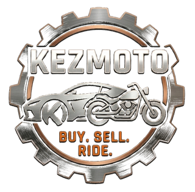
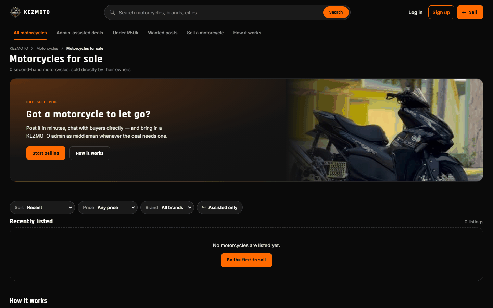
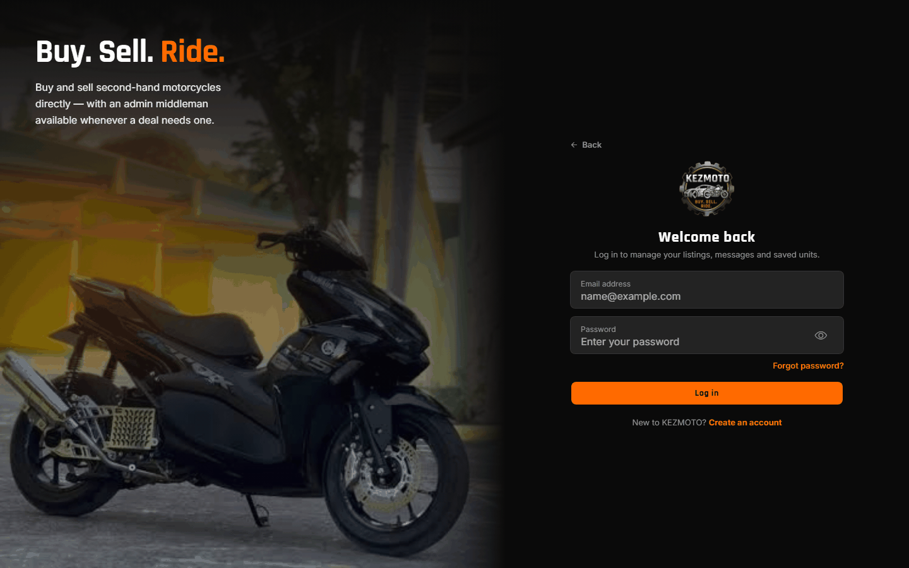
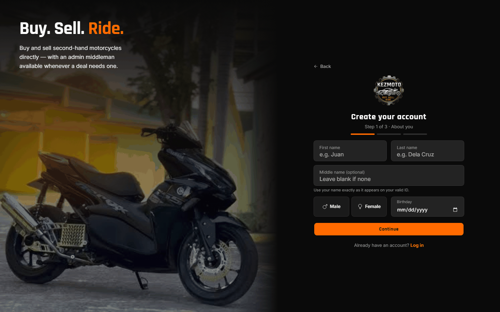
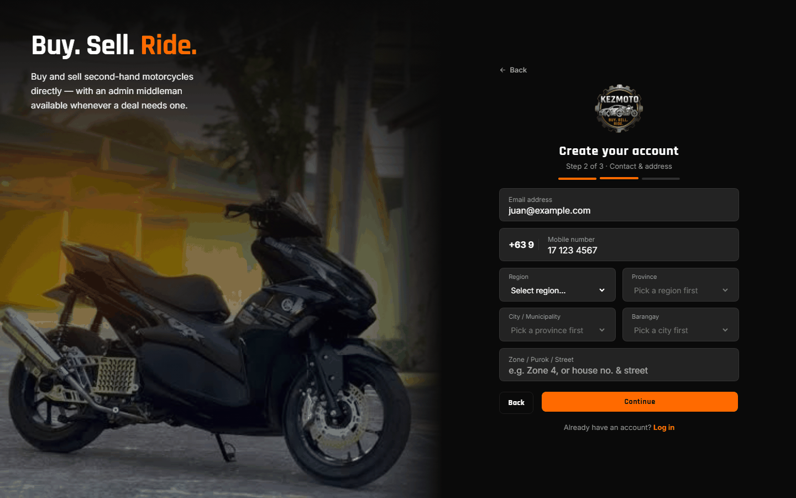
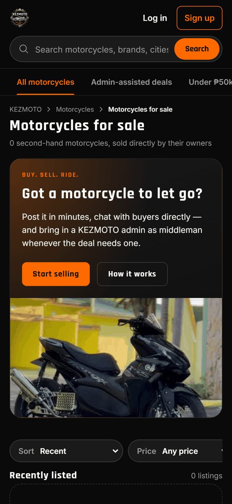
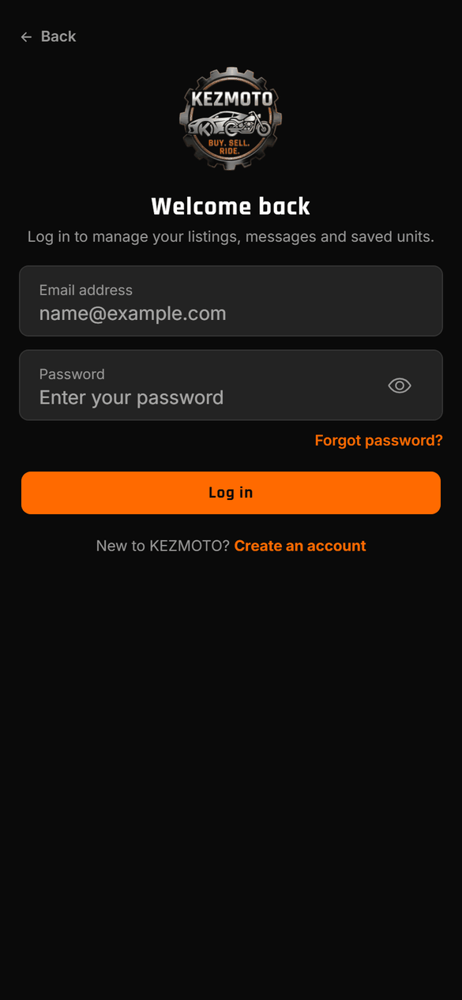
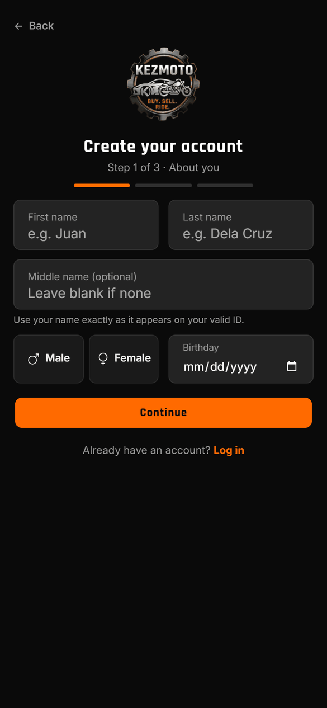

<div align="center">



# KEZMOTO

**Buy. Sell. Ride.** — a second-hand motorcycle marketplace for the Philippines,
with an admin middleman for safer deals.


</div>

---

## About

KEZMOTO helps people buy and sell used motorcycles directly. Sellers post a unit
with photos, documents (OR/CR) and honest condition notes; buyers browse, save,
chat and make price offers. When a deal needs extra trust, a KEZMOTO admin joins
the conversation as a **middleman**, checks the unit and its papers, and guides
both sides to a finished sale.

Everything a buyer needs is free. Sellers pay a small commission only when a
unit sells, and can upgrade to **KEZMOTO Pro** or **Boost** a listing to reach
more buyers.

## Features

| | |
|---|---|
| 🏍️ **Marketplace** | Search by brand, model, city or budget ("under 50k"), filter by price and brand, save favorites |
| 📣 **Wanted posts** | Buyers post what they're looking for; sellers reply |
| 💬 **Messenger-style chat** | Photos, emoji, and in-chat **price offers** (offer · counter · accept) |
| 🛡️ **Admin middleman** | Request an admin for a deal; verification checklist, inspection and meetup tracking |
| 🪪 **Identity verification** | Valid-ID name check plus a live face scan before a seller can post |
| 🤖 **AI features** | Buying assistant chatbot, listing-quality score, condition score, fraud detection (Gemini via Edge Functions) |
| 💸 **GCash commission** | Seller pays 5% (3% on Pro) after a sale; admin confirms the receipt |
| 💎 **KEZMOTO Pro & Boosts** | Unlimited listings, lower commission, Featured placement |
| 🔐 **Secure sign-up** | Email verification code (Brevo SMTP), password reset, +63 mobile, region → barangay address |
| 📱 **Mobile-first** | Bento layout, bottom tab bar, swipe-only scrolling, no-scroll modals |

## Screenshots

| Landing page | Log in |
|---|---|
|  |  |
| **Create account · step 1** | **Create account · step 2** |
|  |  |

<p align="center">
  
  &nbsp;
  
  &nbsp;
  
</p>

## Plans

Buyers never pay. Sellers choose:

| | **Free** | **KEZMOTO Pro** | **Boost** |
|---|---|---|---|
| Price | ₱0 | ₱149 / 30 days | ₱49 / listing |
| Buy, chat, offers, Wanted, middleman, AI assistant | ✓ | ✓ | — |
| Active listings | 3 | Unlimited | — |
| Commission when a unit sells | 5% | 3% | — |
| Featured at the top of Home | — | 2 free boosts per purchase | 7 days |
| PRO badge | — | ✓ | — |

Payments go to KEZMOTO's GCash number; the seller uploads the receipt and an
admin approves it on **Plan Payments**. No payment gateway is required.

## Tech stack

```
Ionic React + TypeScript (Vite)
        │
        ▼
Supabase ── Auth (email code, password reset via Brevo SMTP)
         ├─ Postgres + Row Level Security (36 migrations)
         ├─ Storage (listing photos, documents, IDs, receipts)
         ├─ Realtime (chat, offers, payments)
         └─ Edge Functions ──► Google Gemini (chatbot, scores, ID/face checks, fraud)
        │
        ▼
Render (static site, render.yaml)
```

## Getting started

```bash
npm install
cp .env.example .env.local   # VITE_SUPABASE_URL and VITE_SUPABASE_ANON_KEY
npm run dev                  # http://localhost:5173
```

Set up the Supabase project first — create it, run the migrations in
`supabase/migrations/` in order, configure Brevo SMTP and the email templates:
see **[supabase/README.md](supabase/README.md)**.

| Command | What it does |
|---|---|
| `npm run dev` | Development server |
| `npm run build` | Type-check and production build (`dist/`) |
| `npm run lint` | ESLint |
| `npm run test.unit` | Vitest unit tests |
| `npm run test.e2e` | Cypress end-to-end tests |

## Deployment

The repo includes a Render Blueprint (`render.yaml`): **New → Blueprint** on
render.com, pick this repo, and fill in `VITE_SUPABASE_URL` and
`VITE_SUPABASE_ANON_KEY`. Every push to `main` redeploys. Then set the Render
address as the **Site URL** and a **Redirect URL** in Supabase → Authentication
→ URL Configuration.

## Project structure

```
src/
  pages/        One file per screen (Home, Landing, Auth, Messages, Plans, admin pages…)
  components/   Shared UI (ChatPanel, UnitCard, LocationPicker, PurchaseModal…)
  services/     Supabase data access (listings, chats, payments, plans…)
  context/      Auth, marketplace and sidebar state
  utils/        Pure helpers with unit tests (offers, phone, plans, budget search…)
  theme/        Design tokens and the bento layout system
supabase/
  migrations/   Database schema, RLS and triggers (run in order)
  functions/    Edge Functions (AI features)
  templates/    Branded email templates (sign-up code, password reset)
  scripts/      Maintenance SQL (clear test data)
docs/           Screenshots, logo and the phase-by-phase development notes
```

Detailed notes on how each phase was built: [docs/DEVELOPMENT.md](docs/DEVELOPMENT.md).

## Author

**Kesey G. Decierdo** · Tablon Zone 4, Cagayan de Oro City · 0955 807 1389

© 2026 KEZMOTO. All rights reserved.
